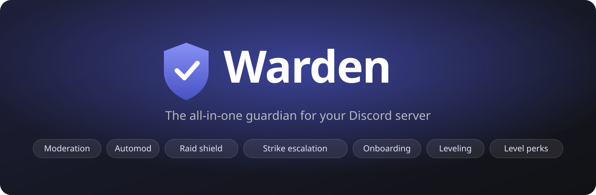
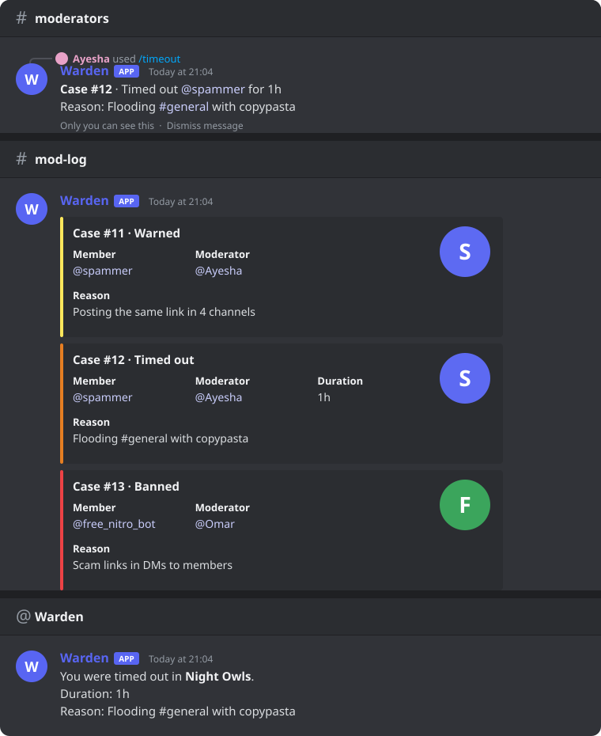
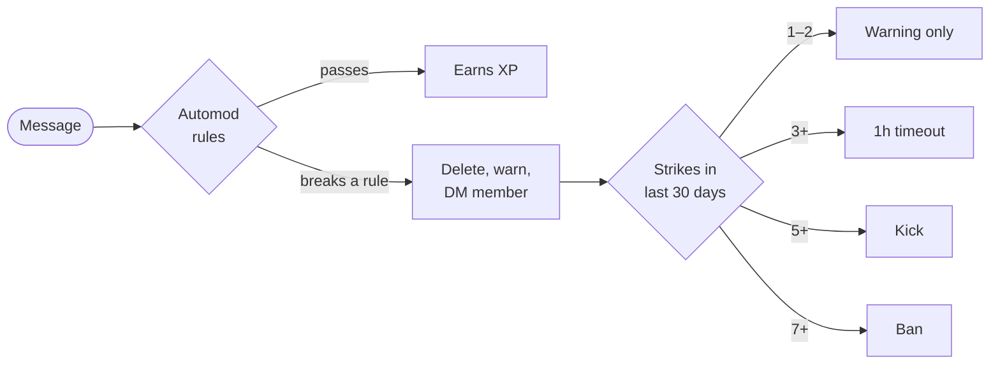
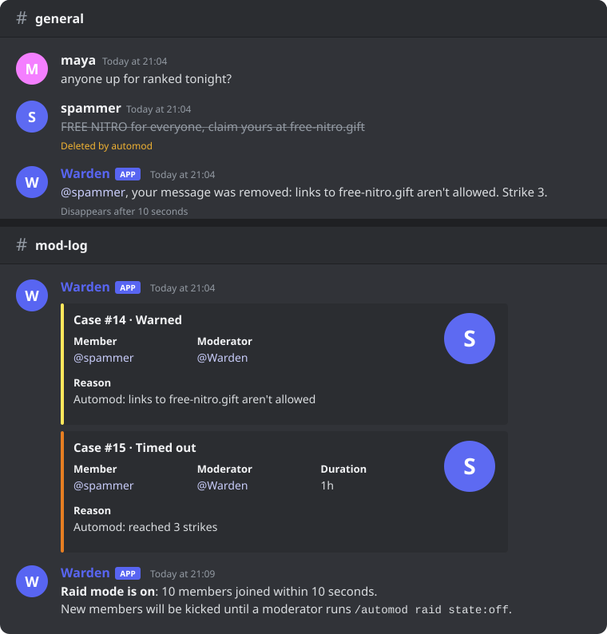
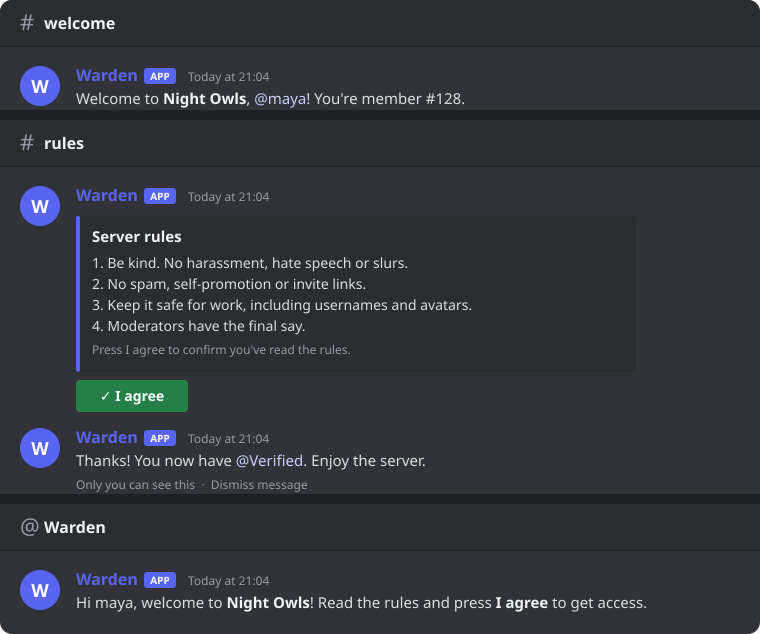
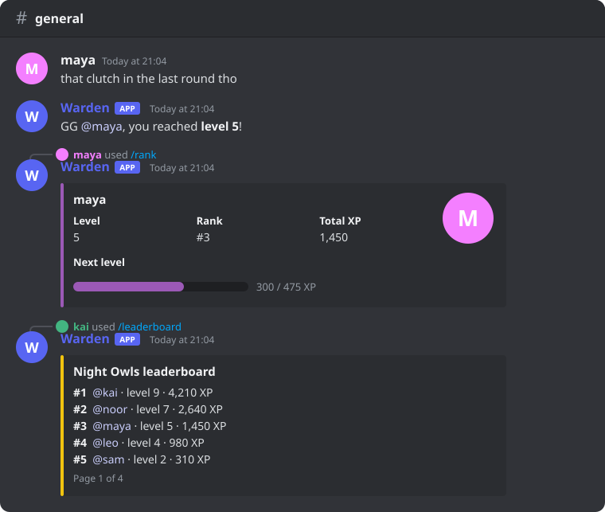
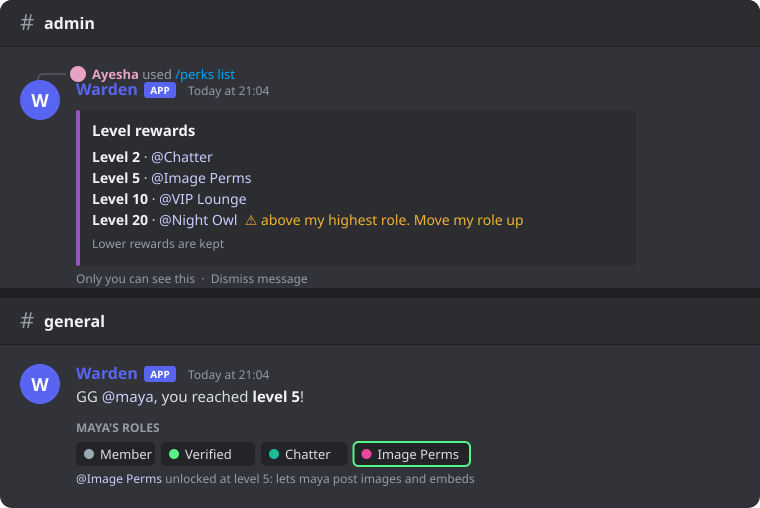
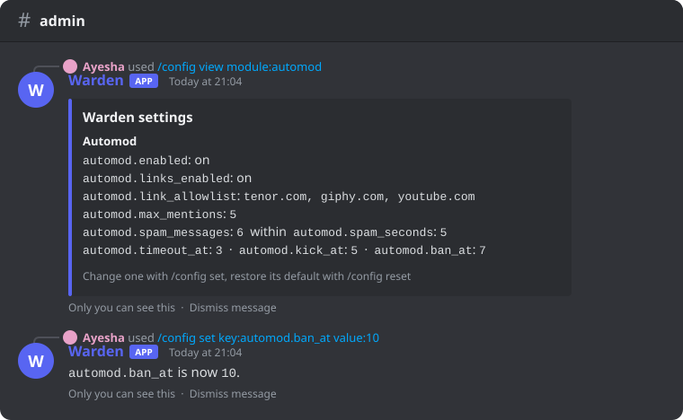
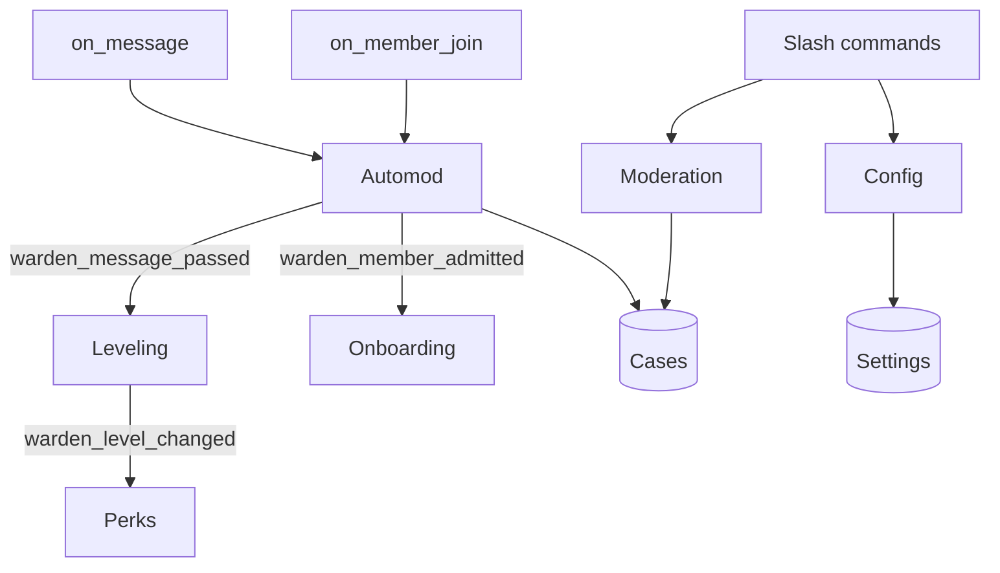

<div align="center">



<br>

[](https://github.com/AzeemChaudhry/Warden_Discord/actions/workflows/ci.yml)
[](https://github.com/AzeemChaudhry/Warden_Discord/actions/workflows/codeql.yml)


A self-hosted Discord bot for moderation, automod, onboarding and leveling,
written in Python with discord.py and SQLite.

[Features](#features) · [Quick start](#quick-start) · [Commands](#commands) ·
[How it's built](#how-its-built) · [Development](#development)

</div>

## Project status

Warden is shelved. Its features work, it's tested, and CI passes, but it has no active
maintainer. It's left public for anyone who wants to use it, learn from it or build on it.
Issues and pull requests are welcome, but replies may be slow.

If you need a hosted bot for a community, established bots such as Carl-bot, Dyno and
Discord's built-in AutoMod cover most of what Warden does. Warden is useful if you want:

- to **self-host** and keep all moderation data in a file you control,
- a **clean codebase to fork** for a custom bot,
- a worked example of a structured discord.py project with tests, CI and migrations.

## Features

### Moderation

`/warn`, `/timeout`, `/untimeout`, `/kick`, `/ban` and `/unban`. Each action:

- checks role hierarchy first. Moderators can't act on members at or above their own role,
  and nobody can act on the server owner or the bot.
- gets a case number and is posted to the mod-log channel.
- is DMed to the member. For kicks and bans the DM is sent before removal, so it can
  still be delivered.

`/cases @user` lists a member's history.

<p align="center"></p>

### Automod

Runs on every message from members who don't have Manage Messages or the exempt role.

| Rule | Behaviour | Settings |
| --- | --- | --- |
| Blocked words | Whole words and phrases, case-insensitive. "heck" won't match "check". | `/automod words add` |
| Links | Blocks domains not on the allowlist. Subdomains are allowed; lookalike domains aren't. | `automod.link_allowlist` |
| Invites | Blocks `discord.gg` and `discord.com/invite` links | `automod.block_invites` |
| Spam | *N* messages within *S* seconds. A burst counts as one strike. | `automod.spam_messages`, `automod.spam_seconds` |
| Mass mentions | Too many users, roles or `@everyone` in one message | `automod.max_mentions` |

A violation deletes the message and records a warning. Warnings within the strike window
count toward escalation, and manual `/warn`s count too:



Every threshold, the timeout length and the window are settings. Set a step to 0 to skip it.

**Raid mode:** if `automod.raid_joins` members join within `automod.raid_seconds` (10 in
10 seconds by default), Warden turns on raid mode and posts an alert in the mod-log. While
it's on, new members are sent a DM and kicked. `/automod raid state:on|off` controls it
manually.

<p align="center"></p>

### Onboarding

- Gives a join role automatically.
- Posts a welcome message in a channel. Placeholders: `{mention}`, `{user}`, `{server}`,
  `{count}`.
- Sends a welcome DM. If the member's DMs are closed, the DM text is added to the channel
  message instead.
- `/onboarding rules` posts your rules with an **I agree** button that gives the verified
  role. The button keeps working after the bot restarts.
- `/onboarding test` runs the whole flow on yourself.

Members blocked by raid mode don't get welcomed.

<p align="center"></p>

### Leveling

- 15–25 XP per message, at most once every 60 seconds. Both are settings.
- Messages removed by automod earn nothing.
- Each level needs more XP than the last.
- `/rank`, `/leaderboard`, and `/xp add|set|reset` for admins.

<p align="center"></p>

### Level perks

`/perks add level:5 role:@Image Perms` gives that role at level 5. Because a perk is just a
role, it can grant a colour, image permissions, or access to a private channel.

- `perks.stack` decides whether members keep lower rewards when they reach a higher one.
- Rewards are removed if a member's XP drops below the level.
- `/perks list` flags roles Warden can't assign.
- `/perks sync` applies rewards to members who already passed a level.

<p align="center"></p>

### Settings, backups and status

All 37 settings are stored per server and changed with `/config set`. Values are checked
before saving: numbers must be in range, and channels and roles must exist.

- `/config export` downloads the settings you've changed as a JSON file.
- `/config import` restores one. Each entry is validated, and channels or roles that don't
  exist in the server are skipped and listed.
- `/status` shows version, uptime, latency, database size and the server's case and XP
  counts.

The [settings reference](docs/SETTINGS.md) is generated from the code, and CI fails if it's
out of date.

<p align="center"></p>

## Quick start

**1. Create the bot** in the [Discord Developer Portal](https://discord.com/developers/applications).
Under **Bot → Privileged Gateway Intents**, enable **Server Members** and **Message Content**.

**2. Invite it.** Replace `APP_ID` with your Application ID, then move Warden's role above
the roles it should manage (**Server Settings → Roles**).

```
https://discord.com/oauth2/authorize?client_id=APP_ID&scope=bot+applications.commands&permissions=1099780156438
```

**3. Configure:**

```sh
git clone https://github.com/AzeemChaudhry/Warden_Discord.git
cd Warden_Discord
cp .env.example .env    # set DISCORD_TOKEN, and DEV_GUILD_ID for instant command sync
```

**4. Run** with Docker:

```sh
docker compose up -d --build
```

or with [uv](https://docs.astral.sh/uv/):

```sh
uv sync
uv run python -m warden
```

With Docker, the database lives in the `warden-data` volume, and `docker compose down`
shuts the bot down cleanly.

**Optional:** `uv run python -m warden.devsetup` (with the bot stopped) creates
`#mod-log`, `#welcome`, `#rules` and test roles in your `DEV_GUILD_ID` server, then sets
all related settings and adds sample perks.

<details>
<summary><b>Permissions and what they're for</b></summary>

| Permission | Used for |
| --- | --- |
| Moderate Members | Timeouts |
| Kick Members, Ban Members | Kicks, bans, escalation, raid mode |
| Manage Roles | Join role, verified role, level perks |
| Manage Messages | Deleting messages that break automod rules |
| Manage Channels | Only `warden.devsetup`, to create test channels |
| View Channels, Send Messages, Embed Links, Read Message History | Replies, logs, announcements |

</details>

<details>
<summary><b>Troubleshooting</b></summary>

- **Log repeats "session has been invalidated":** the privileged intents from step 1
  aren't enabled.
- **Commands don't appear:** check `DEV_GUILD_ID`, restart the bot, then press Ctrl+R in
  Discord. Without a dev guild, global commands can take up to an hour to appear.
- **"Discord refused that action":** Warden's role is below the target's role, or it's
  missing a permission.

</details>

## Commands

| Command | Default access | Description |
| --- | --- | --- |
| `/warn member [reason]` | Moderate Members | Warn and DM a member |
| `/timeout member duration [reason]` | Moderate Members | Timeout, e.g. `10m`, `2h`, `1d12h` (max 28d) |
| `/untimeout member [reason]` | Moderate Members | Lift a timeout |
| `/kick member [reason]` | Kick Members | DM, then kick |
| `/ban user [reason] [delete_days]` | Ban Members | Ban, including users not in the server |
| `/unban user_id [reason]` | Ban Members | Lift a ban |
| `/cases user` | Moderate Members | Moderation history |
| `/automod words add\|remove\|list` | Manage Server | Blocked words |
| `/automod raid state` | Manage Server | Turn raid mode on or off |
| `/onboarding rules channel` | Manage Server | Post rules with a verify button |
| `/onboarding test` | Manage Server | Preview the welcome flow |
| `/rank [member]` | Everyone | Level card |
| `/leaderboard [page]` | Everyone | Server leaderboard |
| `/xp add\|set\|reset` | Manage Server | Adjust XP |
| `/perks add\|remove\|list\|sync` | Manage Roles | Level rewards |
| `/config view\|set\|reset` | Manage Server | Settings |
| `/config export\|import` | Manage Server | Back up and restore settings |
| `/status` | Manage Server | Bot health |

Server owners can change who sees each command under **Server Settings → Integrations**.

## How it's built

### Modules

Each feature is a separate cog. Cogs don't import each other; they communicate through
events, so one can be removed without breaking the rest.



### Layout

```
warden/
├── bot.py           startup, intents, command sync, error replies
├── settings.py      typed per-server settings, validation, cache, backups
├── db.py            SQLite access and numbered migrations
├── modlog.py        cases and mod-log embeds
├── actions.py       shared steps for every action: record, log, DM
├── filters.py       automod rules, independent of Discord objects
├── levels.py        XP curve, leaderboard queries, reward rules
├── durations.py     parsing "1h30m"
├── devsetup.py      test-server setup
├── docs.py          generates docs/SETTINGS.md
└── cogs/            moderation, automod, onboarding, leveling, perks, config, status
```

### Decisions

- **Settings are declared in the module that uses them.** A few lines at the top of a cog
  add a setting to `/config`, autocomplete, backups and the generated docs:

  ```python
  _define = setting_group("leveling")
  COOLDOWN = _define("cooldown_seconds", SettingType.INT, 60,
                     "Seconds before the same member can earn XP again.",
                     min_value=0, max_value=3600)

  seconds = await bot.settings.get(guild.id, COOLDOWN)
  ```

- **Detection and XP logic are kept apart from Discord code**, so they can be unit tested
  without a connection.
- **Settings are cached per server**, so automod doesn't query the database for each message.
- **Migrations only ever get appended.** The schema version is stored in SQLite's
  `user_version`, and CI rejects pull requests that change a shipped migration.
- **Expected failures are handled.** Closed DMs, deleted channels and missing permissions
  are reported to the moderator or logged instead of raising errors.

## Development

```sh
uv sync                                   # runtime and dev dependencies
uv run pytest                             # tests
uv run ruff check . && uv run ruff format .
uv run python -m warden.docs              # regenerate docs/SETTINGS.md
uv run python scripts/render_previews.py  # regenerate the README images
```

### CI

| Workflow | Checks |
| --- | --- |
| CI | Ruff lint and format; tests on Python 3.11, 3.12, 3.13 |
| CI: bot checks | Every slash command against Discord's limits; staff commands have a permission set; settings docs are current; shipped migrations are unchanged |
| CI: Docker | Image builds and exits with a clear error when no token is set |
| CodeQL | Security and code quality, on push and weekly |
| Dependency review | New vulnerable dependencies in pull requests |
| Release | On a `v*` tag: test, build, publish a GitHub release |
| Stale | Closes issues and pull requests with no activity for 74 days |

See [CONTRIBUTING.md](CONTRIBUTING.md) for conventions and [SECURITY.md](SECURITY.md) for
reporting vulnerabilities.
