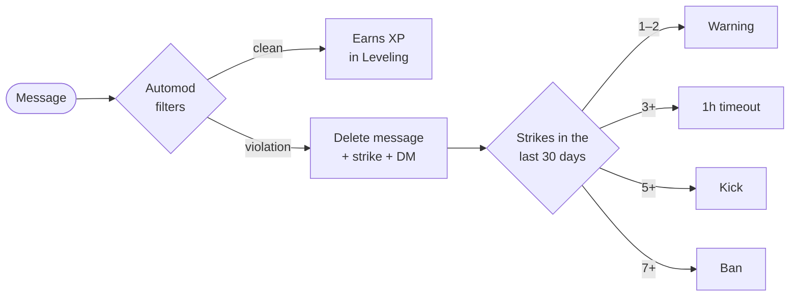
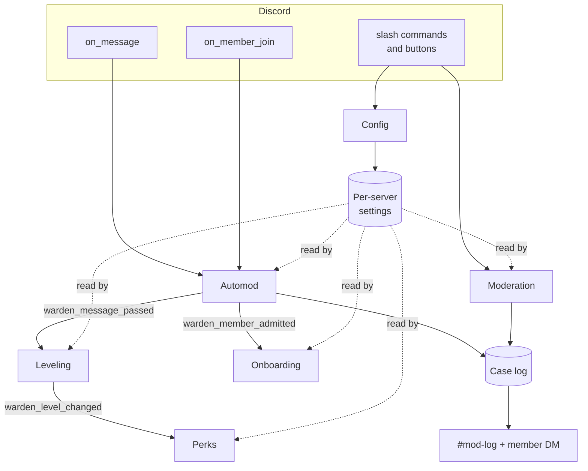

<div align="center">


<br>

[](https://github.com/AzeemChaudhry/Warden_Discord/actions/workflows/ci.yml)
[](https://github.com/AzeemChaudhry/Warden_Discord/actions/workflows/codeql.yml)


[](https://docs.astral.sh/ruff/)

**Moderation, automod, raid protection, onboarding, leveling and level perks in one bot,
configured per server from inside Discord.**

[Features](#what-warden-does) · [Quick start](#quick-start) · [Commands](#command-reference) ·
[Architecture](#under-the-hood) · [Engineering](#built-to-be-maintained) · [Roadmap](#roadmap)

</div>

---

## Why Warden?

Most growing communities stack up five or six bots: one to ban, one to filter, one for
welcomes, one for levels. Each has its own dashboard, its own way of doing things and its
own outages. **Warden replaces them with one bot that shares a single memory of each member.**

- **Everything is connected.** A spam strike from automod and a manual `/warn` land in
  the same case history and count toward the same escalation. Messages automod deletes earn
  no XP. Accounts blocked by raid mode never get a welcome message.
- **Configured in Discord, per server.** 37 settings, each with a sensible default,
  changed with `/config set`. No dashboard to host and no config files to edit.
- **Every action is on the record.** Each warning, timeout, kick and ban gets a case
  number, an entry in your mod-log channel, and a DM to the member.
- **Tested and checked on every commit.** Automated tests, linting, CodeQL scanning, and
  checks that validate every slash command against Discord's rules before it ships.

---

## What Warden does

> The illustrations below show the exact messages Warden sends, drawn in Discord's dark
> theme. `scripts/render_previews.py` generates them.

### Moderation that keeps receipts

`/warn`, `/timeout`, `/kick`, `/ban` and their reversals, all with **role-hierarchy safety
checks**. A moderator can't act on someone ranked equal to or above them, and nobody can
touch the owner or the bot. Each action:

1. replies privately to the moderator with the case number,
2. posts a color-coded case to your **mod-log** channel,
3. **DMs the member** what happened and why. For kicks and bans the DM is sent *before*
   they're removed, while it can still be delivered.

`/cases @user` shows a member's whole history in one place.

<p align="center"></p>

### Automod: your always-on moderator

Every message from a regular member is checked against your rules:

| Rule | What it catches | Tune it with |
| --- | --- | --- |
| **Blocked words** | Whole words and phrases, case-insensitive. Blocking "heck" doesn't block "check". | `/automod words add` |
| **Link filter** | Any domain not on your allowlist (subdomains included, lookalikes not) | `automod.link_allowlist` |
| **Invite blocker** | `discord.gg/…` and `discord.com/invite/…` | `automod.block_invites` |
| **Spam** | *N* messages in *S* seconds; one burst counts as one strike | `automod.spam_messages`, `automod.spam_seconds` |
| **Mass mentions** | Pinging too many users or roles, or `@everyone`, in one message | `automod.max_mentions` |

Staff with Manage Messages, and anyone holding `automod.exempt_role`, are never filtered.

#### Strike escalation

Each violation deletes the message and adds a **strike**. Warden escalates by itself, and
every step is logged as a case:



The thresholds, the timeout length and the 30-day window are all settings. Set a step to 0
to skip it.

#### Raid shield

If **10 accounts join within 10 seconds** (both configurable), Warden switches on raid mode by
itself and alerts your mod-log. Until a moderator runs `/automod raid state:off`, new
joiners get a polite DM and are kicked. Moderators can also turn it on by hand when a raid is
coming.

<p align="center"></p>

### Onboarding that never loses a new member

- **Join role** given automatically.
- **Welcome message** in your channel, with `{mention}`, `{user}`, `{server}` and `{count}`
  placeholders.
- **Welcome DM.** Many members have DMs closed, so Warden detects that and adds the DM text
  to the channel welcome instead. Nobody misses the instructions.
- **Rules with a verify button.** `/onboarding rules` opens a form, posts your rules, and
  attaches an **I agree** button that gives the verified role. The button keeps working
  after restarts.
- `/onboarding test` runs the whole flow on yourself to preview it.

<p align="center"></p>

### Leveling that rewards real conversation

Members earn **15–25 XP per message**, at most once a minute, so spamming doesn't farm
levels. Messages automod deletes earn nothing. Level-ups are announced in the same channel
or one you choose, and the curve gets steeper as levels rise, so higher levels mean
something.

- `/rank`: level, server rank, total XP and a progress bar to the next level
- `/leaderboard`: paged top members
- `/xp add | set | reset`: admin tools for events, giveaways and corrections

<p align="center"></p>

### Perks: roles members unlock by leveling up

`/perks add level:5 role:@Image Perms` and you're done. A perk is any role, so it can grant
anything Discord can:

| Perk idea | How |
| --- | --- |
| **Color role** | A role with a color, placed above other colored roles |
| **Image permissions** | A role with *Attach Files* / *Embed Links* where `@everyone` lacks them |
| **Private channel** | A channel only that role can see |

Choose whether members **keep lower rewards** or swap them for higher ones (`perks.stack`).
If XP is reduced, rewards are removed again. `/perks list` warns you about any reward role
Warden can't assign, before a member runs into it.

<p align="center"></p>

### One settings system for everything

Every module reads its rules from a **per-server settings store**. Admins change them with
autocomplete, and each value is checked before it's saved: numbers must be in range,
channels and roles must exist, and Warden warns if it can't post in a channel you picked.

<p align="center"></p>

**[Full settings reference →](docs/SETTINGS.md)** (generated from the code, so it never
goes out of date)

---

## Quick start

**You need:** Python 3.11+, [uv](https://docs.astral.sh/uv/), and a Discord account.

**1. Create the bot.** In the [Discord Developer Portal](https://discord.com/developers/applications),
create an application. Under **Bot → Privileged Gateway Intents**, enable **Server Members**
and **Message Content**.

**2. Invite it.** Replace `APP_ID` with your Application ID:

```
https://discord.com/oauth2/authorize?client_id=APP_ID&scope=bot+applications.commands&permissions=1099780156438
```

Then drag Warden's role **above** every role it should moderate or hand out
(**Server Settings → Roles**).

**3. Run it:**

```sh
git clone https://github.com/AzeemChaudhry/Warden_Discord.git
cd Warden_Discord
cp .env.example .env            # add DISCORD_TOKEN and DEV_GUILD_ID (your server's ID)
uv sync
uv run python -m warden
```

**4. Optional: set up a test server in one command.** This creates `#mod-log`, `#welcome`,
`#rules` and test roles, wires every setting to them and adds sample level perks:

```sh
uv run python -m warden.devsetup   # run while the bot is stopped
```

<details>
<summary><b>Which permissions does Warden need, and why?</b></summary>

| Permission | Used for |
| --- | --- |
| Moderate Members | `/timeout`, automod timeouts |
| Kick Members / Ban Members | `/kick`, `/ban`, escalation, raid mode |
| Manage Roles | Join role, verified role, level perks |
| Manage Messages | Deleting messages that break automod rules |
| Manage Channels | Only for `warden.devsetup` creating test channels |
| View Channels, Send Messages, Embed Links, Read Message History | Replies, logs, announcements |

</details>

<details>
<summary><b>Troubleshooting</b></summary>

- **"session has been invalidated" over and over:** the privileged intents in step 1
  aren't enabled.
- **Commands don't appear:** check `DEV_GUILD_ID`, restart the bot, then press Ctrl+R in
  Discord. Without a dev guild, global commands can take up to an hour.
- **"Discord refused that action":** Warden's role is below the target's role, or it's
  missing a permission.

</details>

---

## Command reference

| Command | Who can use it | What it does |
| --- | --- | --- |
| `/warn member [reason]` | Moderate Members | Warn and DM a member; counts as a strike |
| `/timeout member duration [reason]` | Moderate Members | Timeout with `10m`, `2h`, `1d12h` (max 28d) |
| `/untimeout member [reason]` | Moderate Members | Lift a timeout |
| `/kick member [reason]` | Kick Members | DM, then kick |
| `/ban user [reason] [delete_days]` | Ban Members | Ban, even users who aren't in the server |
| `/unban user_id [reason]` | Ban Members | Lift a ban |
| `/cases user` | Moderate Members | A member's moderation history |
| `/automod words add \| remove \| list` | Manage Server | Manage blocked words |
| `/automod raid state` | Manage Server | Turn raid mode on or off |
| `/onboarding rules channel` | Manage Server | Post the rules with a verify button |
| `/onboarding test` | Manage Server | Preview the welcome flow on yourself |
| `/rank [member]` | Everyone | Level card |
| `/leaderboard [page]` | Everyone | Server leaderboard |
| `/xp add \| set \| reset` | Manage Server | Adjust a member's XP |
| `/perks add \| remove \| list \| sync` | Manage Roles | Level rewards |
| `/config view \| set \| reset` | Manage Server | Every setting |

These are Discord *default* permissions. Server owners can reassign any command under
**Server Settings → Integrations → Warden**.

---

## Under the hood

### Modules talk through events, not imports

Each feature is an independent cog. They coordinate through custom events, so you can
remove or replace one without breaking the others:



### Project layout

```
warden/
├── bot.py           # startup, intents, command sync, error handling
├── settings.py      # typed, validated, cached per-server settings
├── db.py            # SQLite access and schema migrations
├── modlog.py        # case log + mod-log embeds
├── actions.py       # shared steps for any action: record, log, DM
├── filters.py       # automod detection rules (no Discord objects, easy to unit test)
├── levels.py        # XP curve, leaderboard queries, reward logic
├── durations.py     # "1h30m" ⇄ timedelta
├── devsetup.py      # one-command test server setup
├── docs.py          # generates docs/SETTINGS.md
└── cogs/            # one Discord-facing module per feature
    ├── moderation.py  automod.py  onboarding.py
    └── leveling.py    perks.py    config.py
```

### Design decisions

- **Settings are declared next to the code that uses them.** A module declares its settings
  in a few lines at the top of the file, and they appear in `/config`, in autocomplete and in
  the generated docs without any other code:

  ```python
  _define = setting_group("leveling")
  COOLDOWN = _define("cooldown_seconds", SettingType.INT, 60,
                     "Seconds before the same member can earn XP again.",
                     min_value=0, max_value=3600)

  seconds = await bot.settings.get(guild.id, COOLDOWN)
  ```

- **Pure logic is kept apart from Discord code.** Word matching, link parsing, spam
  windows, the XP curve and reward rules have no Discord dependencies, so they're tested
  directly and quickly.
- **Migrations only ever get added.** Schema changes are numbered migrations tracked with
  SQLite's `user_version`. CI rejects any pull request that edits one that already shipped.
- **Settings are cached per server** after the first read, so automod checks every message
  without querying the database each time.
- **Failures don't crash anything.** Closed DMs, deleted channels and missing permissions
  are caught and explained, to the moderator in a private reply or in the logs, instead of
  surfacing as errors.

---

## Built to be maintained

| Workflow | What it does |
| --- | --- |
| **CI** | Ruff lint + format check, then the full test suite on Python 3.11, 3.12 and 3.13 |
| **Bot checks** | Loads every cog offline and validates each slash command against Discord's naming, length and permission rules; fails if `docs/SETTINGS.md` is out of date; blocks edits to shipped migrations |
| **CodeQL** | Security and quality scanning on every push and weekly |
| **Dependency review** | Flags vulnerable dependencies added in a pull request |
| **Dependabot** | Weekly grouped updates for Python packages and GitHub Actions |
| **Release** | Tag `v*` → tests, build, GitHub release with generated notes |
| **Stale** | Closes issues and PRs with no activity for 74 days |

The tests also enforce rules such as *every staff command must require a permission* and
*every command is server-only*, so one forgotten decorator can't open `/ban` to everyone.

### Develop locally

```sh
uv sync                              # install everything, including dev tools
uv run pytest                        # run the tests
uv run ruff check . && uv run ruff format .
uv run python -m warden.docs         # regenerate the settings reference
uv run python scripts/render_previews.py   # regenerate the README illustrations
```

See [CONTRIBUTING.md](CONTRIBUTING.md) for conventions and [SECURITY.md](SECURITY.md) for
reporting vulnerabilities.

---

## Roadmap

- [x] Per-server settings system
- [x] Moderation with case log and DMs
- [x] Automod: words, links, invites, spam, mass mentions
- [x] Strike escalation and raid shield
- [x] Onboarding with DM fallback and button verification
- [x] Leveling with anti-farming cooldown, `/rank` and leaderboard
- [x] Level perks
- [ ] **AI moderation:** toxicity scoring on flagged messages, escalated to moderators with
  context
- [ ] Web dashboard for settings and case history
- [ ] Postgres backend for multi-instance hosting

---

<div align="center">

### Want a bot like this for your community or product?

Warden shows the whole process: design, architecture, testing, CI and documentation.
Custom moderation, onboarding, engagement or AI-assisted bots can be built the same way.

**[Get in touch →](https://github.com/AzeemChaudhry)**

<sub>Built with discord.py, SQLite and uv.</sub>

</div>
